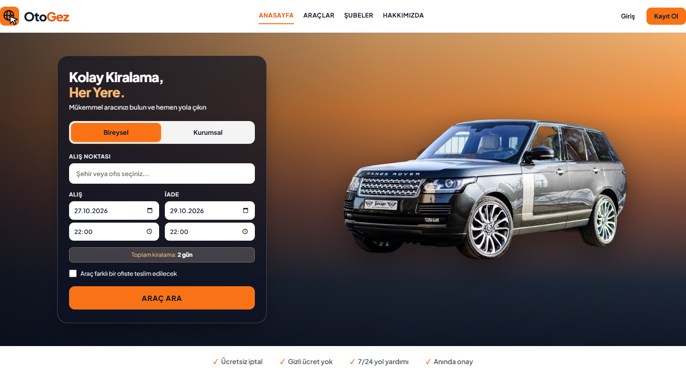
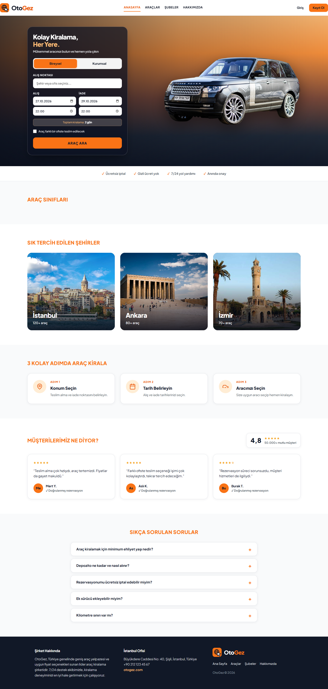
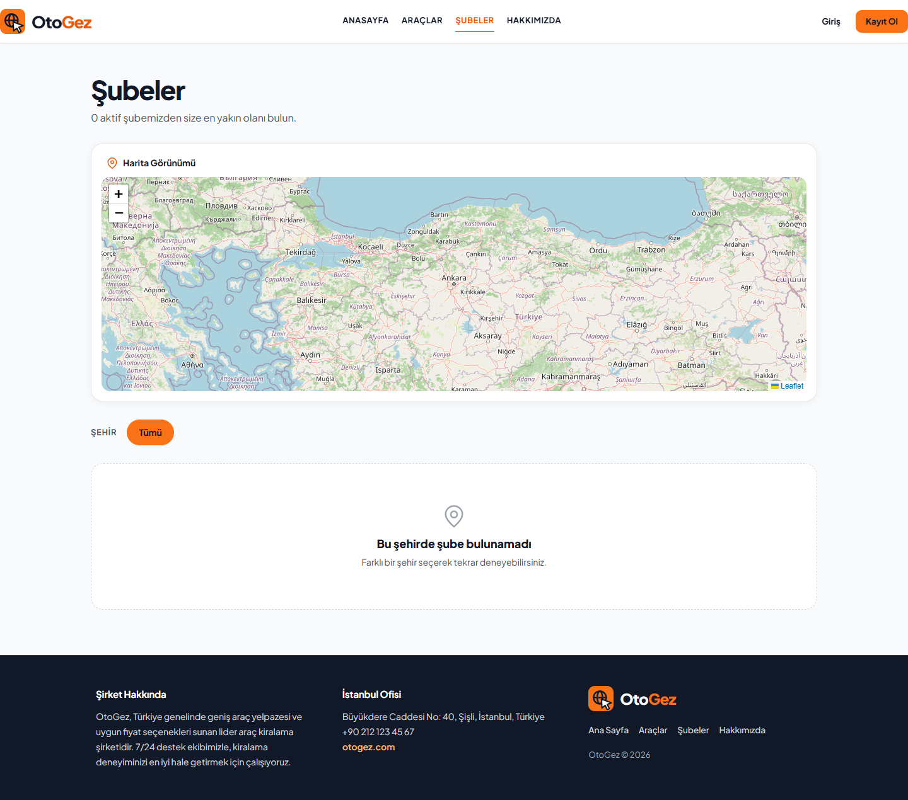
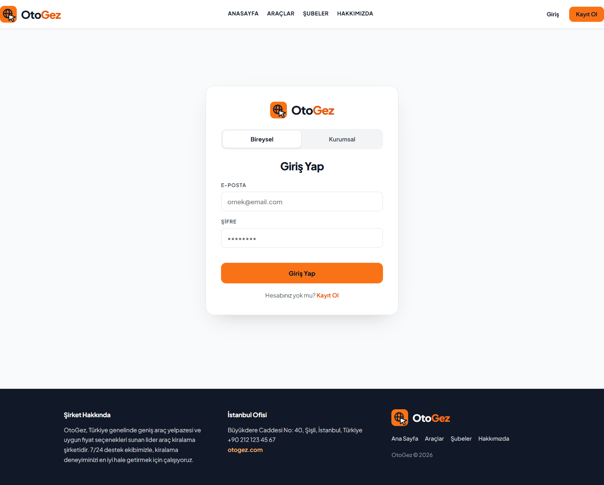
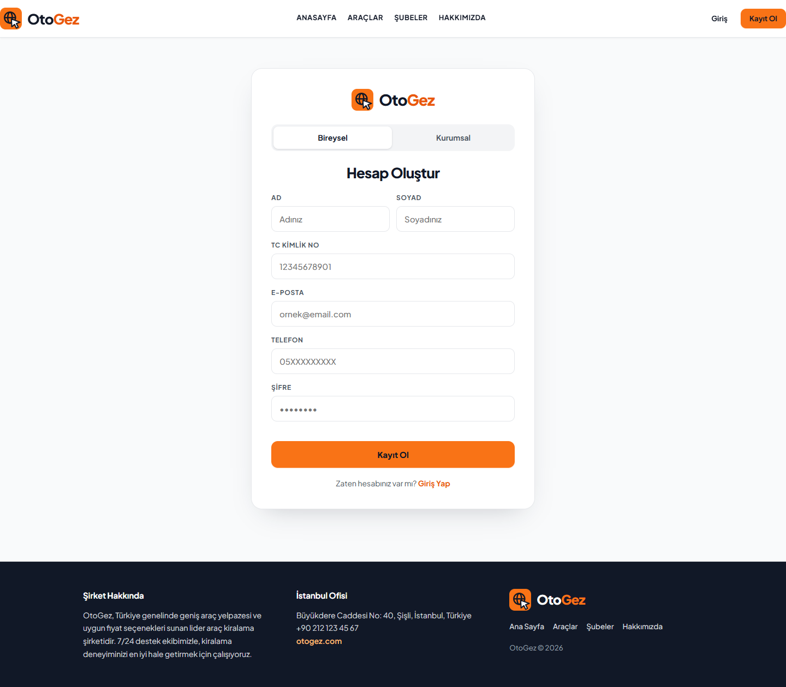
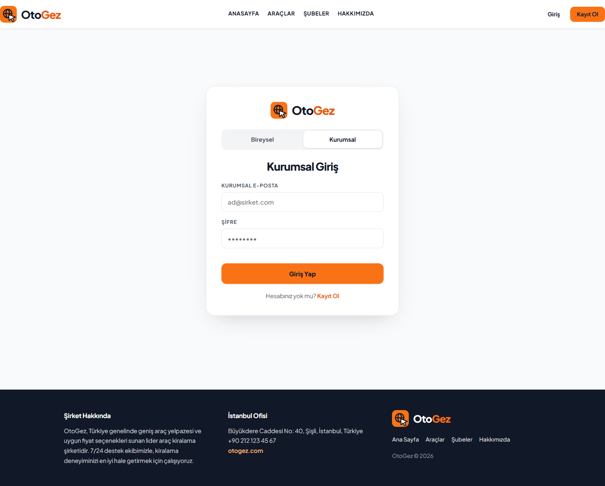
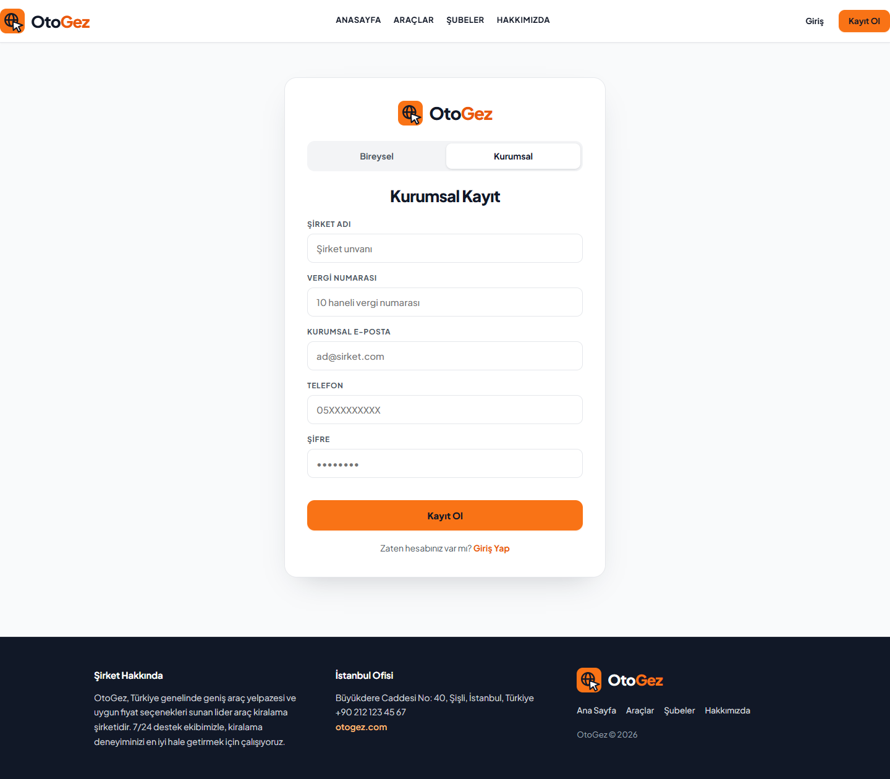
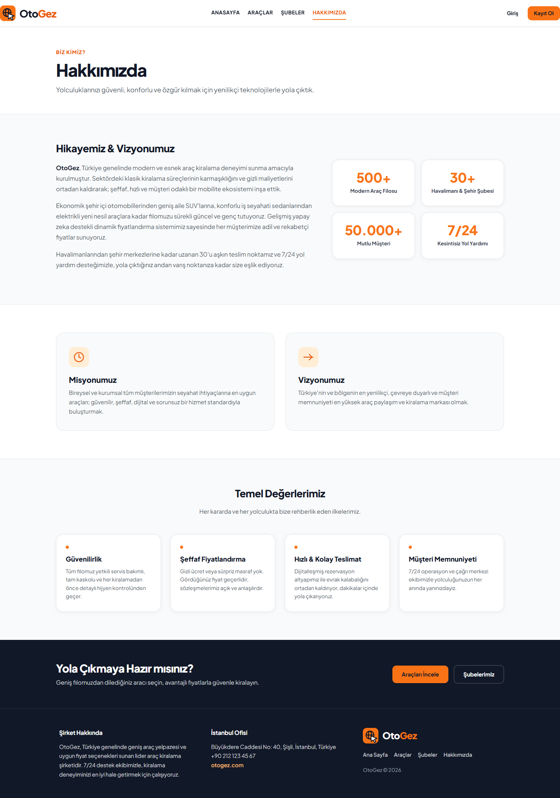

# OtoGez — Angular 19 Car Rental Frontend

<div align="center">


**A standalone-component Angular 19 single-page application for a car rental business — public vehicle catalog, multi-criteria filtering, a Leaflet branch locator, individual and corporate authentication portals, and an administrative Reinforcement Learning pricing dashboard.**

This repository contains **the frontend only**. Every data-driven screen consumes a separately maintained
[backend API service](https://github.com/kamiltuncok/CarProject) over HTTP.

</div>

---

## Screenshots

All images below are real captures of this Angular application running locally
(`ng serve`, Chrome, 1440 × 1000 viewport).

> **Note on data:** these captures were taken with the backend API **not running**, so lists populated
> from HTTP responses (vehicle cards, branch markers, vehicle-class tiles, office dropdowns) appear in
> their empty or placeholder state. The layout, navigation, forms, map and component chrome shown are
> exactly what the application renders. Screens that cannot render at all without the API — or that sit
> behind a role-based guard — are **not** shown here; see
> [Not captured in this gallery](#not-captured-in-this-gallery).

### Booking & Catalog

**Landing page — hero booking search.** The reservation entry point: an individual/corporate mode
toggle, a pickup-office selector, pickup and return date/time pickers with a live rental-duration
readout, and a "return to a different office" option.



**Full home page layout** — hero search, trust bar, vehicle-class grid, featured cities, the three-step
rental explainer, customer testimonials, FAQ accordion and footer. The *Araç Sınıfları* (vehicle class)
band between the trust bar and the city cards is rendered from `segments` plus per-segment lowest-price
API calls, and is therefore empty in this capture.



### Branch Locator

The `/branches` screen initialises a **Leaflet** map centred on Türkiye with OpenStreetMap tiles on
component init, independently of the API. Branch markers and their popups, the city filter chips and the
branch cards are all built from `locations` / `locationcities` responses — with the API offline the map
renders but the branch list falls back to its empty state.



### Authentication Portals

| Individual login | Individual registration |
|---|---|
|  |  |

| Corporate login | Corporate registration |
|---|---|
|  |  |

Both auth screens share a segmented **Bireysel / Kurumsal** control that routes between the individual
and corporate flows. The individual form collects name, national ID, e-mail, phone and password; the
corporate form swaps those for company name and tax number.

### About



### Not captured in this gallery

| Screen | Route | Why it is missing |
|---|---|---|
| Vehicle catalog with filters | `/cars` | The whole template is behind `*ngIf="dataLoaded"`, and `dataLoaded` is set only inside the success callback of `getCarDetails()`. With no API the page stays on *"Araç filomuz yükleniyor…"*. |
| Search results list | `/home/carlist` | Same `dataLoaded` gate, fed by `POST /cars/available`. Renders blank without the API. |
| Vehicle details & booking | `/carDetail/:carId` | Template is behind `*ngIf="carDetail"`, populated from `GET /cars/details/{id}`. Renders blank without the API. |
| RL pricing dashboard | `/admin/pricing` | Protected by `AdminGuard`; without a real admin JWT issued by the backend the router redirects to `/login`. No token was forged to bypass this. |
| Pricing performance / A-B metrics | `/admin/pricing` | Same guard. The metric cards are also driven by `GET /cars/pricing/performance`. |
| Fleet & inventory management | `/cars/add`, `/brands/add`, `/colors/add`, `/locations/add`, `/location-managers` | All behind `AdminGuard`. |
| Customer profile & rentals | `/profile`, `/rentals`, `/location-rentals` | Behind `LoginGuard`; redirect to `/login` when unauthenticated. |

No mock server, stubbed HTTP layer, fabricated response or forged token was used to produce any image
in this README.

---

## Frontend Feature Overview

* **Public browsing** — home, vehicle catalog, branch locator and about pages are reachable without a session.
* **Two-track identity** — parallel *individual* and *corporate* login and registration flows, each with its own form model and API endpoint.
* **Role-aware navigation** — the navbar and route guards react to the roles decoded from the JWT (`admin`, `locationmanager`, `corporate`).
* **Reservation funnel** — hero search → results list → vehicle detail → payment, implemented as lazy-loaded standalone components.
* **Interactive geography** — Leaflet map with custom branch markers, popup cards, per-city filtering and deep-linking through a `?location=` query parameter.
* **Administrative surfaces** — vehicle, brand, colour, image and location CRUD screens plus location-manager assignment, all guarded.
* **RL pricing control panel** — an admin dashboard that reads pricing recommendations and A/B performance metrics from the API and can trigger repricing actions.
* **Global HTTP behaviour** — a functional auth interceptor attaches the bearer token, and a functional error interceptor maps 401/403/404/500/offline responses to toast notifications.

---

## Vehicle Catalog, Filtering, Details & Booking UI

### Hero search (`car-search-form`)

The landing-page search card is the reservation entry point. It offers an individual/corporate mode
toggle, a pickup-office selector populated from `GET /locations`, pickup and return date and time inputs,
a computed total-days readout, and an optional *"vehicle will be returned to a different office"*
checkbox that reveals a second office selector. Submitting navigates to `/home/carlist` carrying the
selection as route state.

### Catalog (`car` component, `/cars`)

A two-column catalog: a sticky left filter panel and a results grid. Implemented filters, each bound to
its own API-sourced option list:

| Filter | Source |
|---|---|
| Free-text brand/model search | client-side, over the loaded catalog |
| Brand | `GET /brands` |
| Segment (vehicle class) | `GET /segments` |
| Fuel type | `GET /fuels` |
| Transmission | `GET /gears` |
| Maximum daily price | range slider, bounds derived from the loaded catalog |

A result counter and a *clear filters* link reflect the active filter set.

### Search results (`car-list`, `/home/carlist`)

Shows a summary bar for the chosen pickup and return offices, dates and duration, plus a sidebar of
checkbox filters (fuel, transmission and further criteria) applied to the availability response from
`POST /cars/available`.

### Vehicle details & payment (`car-detail`, `payment`)

The detail component loads a single vehicle via `GET /cars/details/{carId}` and its gallery via
`GET /carimages/car/{carId}`, then renders specifications and the daily price alongside the booking
call-to-action. The payment route is guarded by `LoginGuard`.

> The catalog, results and detail screens are fully implemented in this repository but could not be
> visually verified here, because each gates its template on a successful API response.

---

## Leaflet Branch Locator

`BranchesComponent` (`/branches`) is the geospatial feature of the app:

* Creates an `L.map` on `ngOnInit`, centred on `[39.9334, 32.8597]` at zoom 6 with OpenStreetMap raster tiles.
* Loads cities from `GET /locationcities`, then branches from `GET /locations`.
* Adds one `L.marker` per branch using a custom icon (`assets/images/location.png`), bound to a popup showing branch name, city, address, phone and e-mail.
* Fits the viewport to the marker bounds via `L.featureGroup(...).getBounds()`.
* Supports a highlighted branch: navigating with `?location=<branch name>` swaps that marker for a larger highlighted icon and opens its popup — this is how the home page's city cards deep-link into the map.
* Renders city filter chips and a card grid beneath the map, with a dedicated empty state.

The map itself is verified working in the screenshot above; markers and popups require branch data from
the API.

---

## Role-Based Portals & Authentication Flow

### Session mechanism

`AuthService` is built on Angular **signals**:

```ts
readonly currentUser       = signal<DecodedToken | null>(this.tryDecodeToken());
readonly isAuthenticated   = computed(() => this.currentUser() !== null);
readonly isAdmin           = computed(() => this.getRolesFromToken(this.currentUser()).includes('admin'));
readonly isLocationManager = computed(() => /* locationmanager role variants */);
readonly customerType      = computed<'Corporate' | 'Individual'>(() => /* corporate role */);
```

The single source of truth is the decoded JWT. On login the raw token is written to `localStorage` under
the key `token` through `LocalStorageService`, then `applyToken()` re-decodes it and updates the signals
so the navbar re-renders without a page reload. `tryDecodeToken()` checks expiry with
`JwtHelperService.isTokenExpired()` and clears an expired token.

> **Security note:** the token is kept in `localStorage`, which is readable by any script running on the
> origin. This is a convenience choice for a portfolio SPA, not a hardened session design. Role checks
> performed in the browser are a UX affordance only — authorization is enforced server-side.

### Guards

Both guards are functional `CanActivateFn`s using `inject()`:

| Guard | Behaviour |
|---|---|
| `loginGuard` | Allows the route when `isAuthenticated()`; otherwise toasts and redirects to `/login`. |
| `adminGuard` | Redirects unauthenticated users to `/login`; authenticated non-admins are sent to `/` with an authorization error toast. |

### Portals

| Portal | Entry routes | Guard |
|---|---|---|
| Individual customer | `/login`, `/register`, `/profile`, `/rentals` | `LoginGuard` on the authenticated routes |
| Corporate customer | `/loginforcorporate`, `/registerforcorporate` | — (auth routes are public) |
| Location manager | `/location-rentals`, `/location-manager-profile` | `LoginGuard` |
| Administrator | `/admin/pricing`, `/cars/add`, `/brands/add`, `/colors/add`, `/carimages/add`, `/locations/add`, `/location-managers*` | `AdminGuard` |

---

## Reinforcement Learning Dynamic Pricing Dashboard

`PricingDashboardComponent` at `/admin/pricing` is an **administrative client for a pricing engine that
lives behind the backend API**. The Angular application does not train, host or run any Q-learning
model — it calls HTTP endpoints and renders what they return.

What the component implements:

* **A/B measurement card** — a configurable *last N days* window driving `GET /cars/pricing/performance`, rendering revenue-per-decision for the RL group against a fixed-price control group, the uplift between them, decision and realized-rental counts, average reward, and any `notes` the API returns, surfaced as warnings.
* **Recent decisions table** — per decision: vehicle id, old price, new price, price change, reward, and a human-readable rendering of the state key at decision time.
* **Fleet table** — id, plate, segment, current daily price, a per-vehicle *get recommendation* action (`GET /cars/{carId}/recommended-price`, which returns advice text and does not change the price), and a per-vehicle *reprice* action (`POST /cars/{carId}/update-price`).
* **Fleet-wide actions** — *price the whole fleet* (`POST /cars/update-prices-batch`) and *settle rewards* (`POST /cars/settle-rewards`), which closes out the reward for decisions whose evaluation window has elapsed, using realized rentals.

`PricingService` deliberately routes every one of these calls through the main backend API rather than
contacting a pricing microservice directly, so that JWT authorization and CORS stay in one place.

> This dashboard is **not** shown in the screenshot gallery. Reaching it requires an admin JWT issued by
> the backend; without one `AdminGuard` redirects to `/login`. Its batch-repricing and reward-settlement
> buttons are also state-changing operations, and were not executed.

---

## Frontend Architecture

The application is **entirely standalone components** — there is no `NgModule` anywhere in `src/app`.
Bootstrapping happens in `main.ts` via `bootstrapApplication(AppComponent, appConfig)`.

### Application config

```ts
// src/app/app.config.ts
export const appConfig: ApplicationConfig = {
    providers: [
        provideRouter(routes),
        provideAnimations(),
        provideHttpClient(withInterceptors([authInterceptor, errorInterceptor])),
        provideToastr({ positionClass: 'toast-bottom-right' }),
        { provide: JWT_OPTIONS, useValue: JWT_OPTIONS },
        JwtHelperService,
    ],
};
```

### Routing

Every route is lazy-loaded with `loadComponent: () => import(...)`, so each screen ships as its own
chunk. Guards are attached declaratively through `canActivate`.

### Directory layout

```
src/
├── app/
│   ├── components/              # one folder per standalone component
│   │   ├── home/                # landing page
│   │   ├── car-search-form/     # hero reservation search widget
│   │   ├── car/                 # vehicle catalog + filter panel
│   │   ├── car-list/            # availability results
│   │   ├── car-detail/          # specs, gallery, booking CTA
│   │   ├── payment/             # checkout step
│   │   ├── branches/            # Leaflet branch locator
│   │   ├── pricing-dashboard/   # RL pricing admin panel
│   │   ├── login/ register/     # individual auth
│   │   ├── loginforcorporate/ registerforcorporate/
│   │   ├── profile/ rental/     # customer area
│   │   ├── location-manager-*/  # branch manager screens
│   │   ├── car-add/ car-update/ brand-*/ color-*/ car-image-add/ location-add/
│   │   └── navi/ footer/ about/ # shell + static pages
│   ├── services/                # one injectable per API resource
│   ├── models/                  # TypeScript interfaces for requests and responses
│   ├── guards/                  # loginGuard, adminGuard (functional CanActivateFn)
│   ├── interceptors/            # authInterceptor, errorInterceptor (functional)
│   ├── pipes/                   # client-side list filters
│   ├── app.config.ts            # providers
│   ├── app.routes.ts            # lazy route table
│   └── app.component.*          # shell: navbar + <router-outlet> + footer
├── assets/                      # images, Leaflet marker icons
├── index.html
├── main.ts
└── styles.css
```

### Response envelope

Every service is typed against a consistent API envelope:

```ts
interface ResponseModel          { success: boolean; message: string; }
interface SingleResponseModel<T> extends ResponseModel { data: T; }
interface ListResponseModel<T>   extends ResponseModel { data: T[]; }
```

---

## Technology Stack

| Area | Technology |
|---|---|
| Framework | Angular 19.2 (standalone components, signals, functional guards and interceptors) |
| Language | TypeScript 5.8 |
| Reactivity | RxJS 7.8, Angular signals (`signal`, `computed`) |
| Routing | `@angular/router` with `loadComponent` lazy loading |
| Forms | `@angular/forms` (template-driven and reactive) |
| HTTP | `@angular/common/http` with `withInterceptors([...])` |
| Auth | `@auth0/angular-jwt` 5.1 (`JwtHelperService` for decode and expiry) |
| Maps | Leaflet 1.9 with `@types/leaflet`, OpenStreetMap tiles |
| UI | Bootstrap 5.2, ngx-bootstrap 11, custom CSS design system |
| Notifications | ngx-toastr 16 |
| Build | Angular CLI 19.2 / `@angular-devkit/build-angular` |
| Tests | Karma + Jasmine (scaffolded) |

---

## Installation & Local Development

### Prerequisites

* Node.js 18.19+ or 20.11+ (Angular 19 requirement)
* npm 9+

### Setup

```bash
git clone https://github.com/kamiltuncok/rentacar.git
cd rentacar
npm install
```

### Run the dev server

```bash
npm start          # equivalent to: ng serve
```

The application is served at **http://localhost:4200/** with hot module reload.

Public screens (home, branches, about and all four auth forms) render immediately. Catalog, detail,
profile and admin screens need the backend API — see below.

---

## Configuration & API URL Settings

This project has **no `src/environments/` files and no `.env`**. Each service declares the API base URL
as a class field:

```ts
// src/app/services/car.service.ts
apiUrl = "https://localhost:44306/api/";
```

The same `https://localhost:44306/api/` origin is hardcoded across every service in
`src/app/services/`, with several services appending their own resource segment
(`.../api/auth/`, `.../api/corporatecustomers/`, `.../api/individualcustomers/`,
`.../api/locationmanagers`, `.../api/cars/`).

**To point the frontend at a different backend host**, update the `apiUrl` field in the service files
under `src/app/services/`. Introducing `src/environments/environment.ts` and injecting the value would
be the natural refactor, but it is not implemented today — this README documents the code as it stands.

Because the backend is served over **HTTPS on `localhost:44306` with a development certificate**, the
browser must trust that certificate before any XHR succeeds; otherwise requests fail at the TLS layer
and the error interceptor surfaces a *"Sunucuya bağlanılamıyor"* toast.

---

## API Integration Reference

The endpoints below are transcribed from the service definitions in `src/app/services/`. They describe
what **this frontend calls**; the contracts are owned and implemented by the separate backend service.

### Auth — `auth.service.ts`

| Method | Endpoint |
|---|---|
| `POST` | `/api/auth/login` |
| `POST` | `/api/auth/loginforcorporate` |
| `POST` | `/api/auth/register` |
| `POST` | `/api/auth/registerforcorporate` |
| `POST` | `/api/auth/registeradmin` |
| `PUT`  | `/api/auth/password` |

### Catalog — `car`, `brand`, `color`, `fuel`, `gear`, `segment`, `car-image` services

| Method | Endpoint | Used by |
|---|---|---|
| `GET`  | `/api/cars/details` | catalog list |
| `GET`  | `/api/cars/details/{carId}` | vehicle detail |
| `GET`  | `/api/cars/brand/{brandId}` | brand-filtered catalog route |
| `GET`  | `/api/cars/color/{colorId}` | colour-filtered catalog route |
| `POST` | `/api/cars/available` | availability search from the hero form |
| `GET`  | `/api/cars/segment/{segmentId}/lowest-price` | "from ₺X/day" on the home vehicle-class tiles |
| `POST` / `PUT` | `/api/cars`, `/api/cars/{id}` | admin fleet CRUD |
| `GET`  | `/api/brands`, `/api/colors`, `/api/fuels`, `/api/gears`, `/api/segments` | filter option lists |
| `GET`  | `/api/carimages/car/{carId}` | vehicle gallery |

### Locations — `location.service.ts`

| Method | Endpoint |
|---|---|
| `GET` | `/api/locations` |
| `GET` | `/api/locations/city/{cityId}` |
| `GET` | `/api/locationcities` |

### Rentals — `rental.service.ts`

| Method | Endpoint |
|---|---|
| `GET`  | `/api/rentals`, `/api/rentals/user/{userId}`, `/api/rentals/manager/{managerId}` |
| `GET`  | `/api/rentals/date-range?startDate=&endDate=` |
| `POST` | `/api/rentals/create`, `/api/rentals/createguest` |
| `POST` | `/api/rentals/{id}/deliver`, `/mark-as-returned`, `/collect-deposit`, `/cancel` |

### RL pricing — `pricing.service.ts`

| Method | Endpoint | Effect |
|---|---|---|
| `GET`  | `/api/cars` | fleet list for the dashboard table |
| `GET`  | `/api/cars/{carId}/recommended-price` | read-only recommendation text |
| `POST` | `/api/cars/{carId}/update-price` | **writes** a new price for one vehicle |
| `POST` | `/api/cars/update-prices-batch` | **writes** new prices across the fleet |
| `POST` | `/api/cars/settle-rewards` | **writes** reward settlement for matured decisions |
| `GET`  | `/api/cars/pricing/performance?lastDays=N` | A/B metrics |

### Customers & users

`individual-customer.service.ts`, `corporate-customer.service.ts`, `customer.service.ts`,
`user.service.ts` and `location-manager.service.ts` target
`/api/individualcustomers/`, `/api/corporatecustomers/`, `/api/users/` and `/api/locationmanagers`.

### Request and response handling

* `authInterceptor` reads `localStorage.token`, strips stray surrounding quotes, and sets `Authorization: Bearer <token>` on every outgoing request when a token exists.
* `errorInterceptor` catches `HttpErrorResponse` and maps status codes to toasts: `401` → redirect to `/login`, `403` → permission error, `404` → not found, `500` → server error, `0` → cannot reach server.

---

## Production Build

```bash
npm run build          # ng build
```

Output is emitted to **`dist/rentacar/`** as static assets, ready to be served by any static host or
CDN. Watch-mode development builds:

```bash
npm run watch          # ng build --watch --configuration development
```

Unit test scaffolding (Karma + Jasmine):

```bash
npm test               # ng test
```

---

## Repository Links

| | |
|---|---|
| **Frontend (this repository)** | https://github.com/kamiltuncok/rentacar |
| **Backend API service** | https://github.com/kamiltuncok/CarProject |

---

## License

Released under the terms in [LICENSE](LICENSE).
